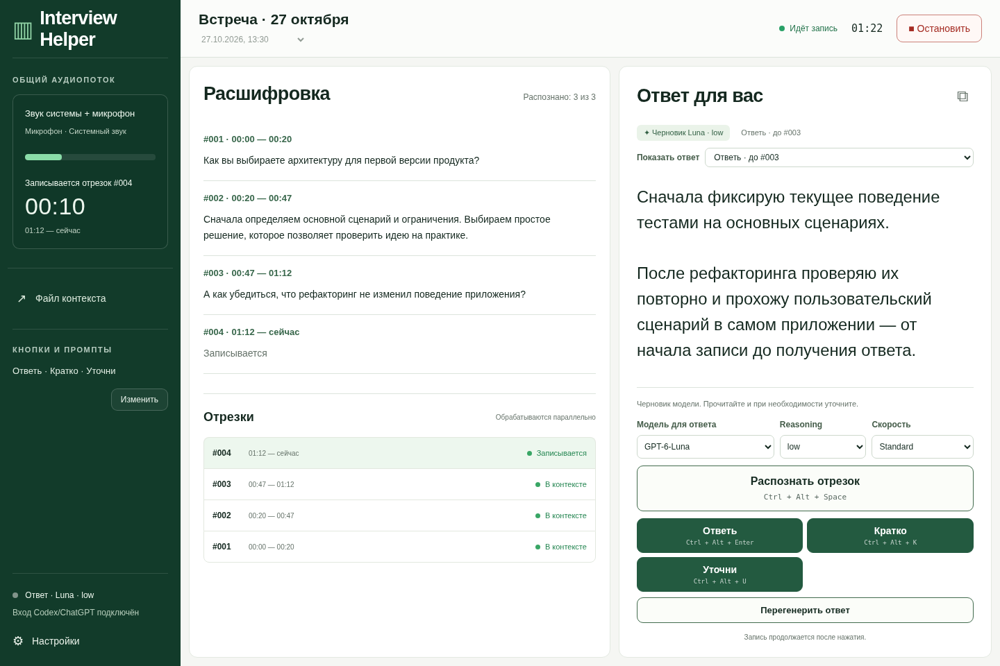

# Interview Helper

Настольный помощник для встреч и интервью: записывает системный звук и микрофон в один поток, отправляет отдельные отрезки на распознавание через существующий вход Codex/ChatGPT и сохраняет расшифровки в общий контекст. Генерация вызывается кнопками с настраиваемыми промптами или командой **«Перегенерить ответ»**; по умолчанию используется **Luna (`gpt-6-luna`) / low**. Модель, reasoning и скорость **Standard / Fast** выбираются прямо в панели ответа из каталога установленного Codex; для каждой модели показываются поддерживаемые уровни.



*Скриншот рабочего интерфейса с демонстрационными данными.*

## Поддержка платформ

| Платформа | Состояние |
| --- | --- |
| Linux / NixOS | Работает захват через PipeWire/PulseAudio и FFmpeg. Глобальные сочетания поддерживаются в Hyprland. |
| Windows | Общий код отделён от ОС; захват, горячие клавиши и локальный канал управления ещё нужно реализовать. |
| macOS | Общий код отделён от ОС; захват, горячие клавиши и локальный канал управления ещё нужно реализовать. |

На Windows и macOS системные адаптеры пока возвращают явную ошибку о неподдерживаемой платформе. Полноценный запуск приложения на этих ОС ещё не поддерживается.

## Запуск на Linux

### NixOS / Nix

```bash
nix run .
```

Нужны работающие PipeWire с PulseAudio-совместимым сервером, Hyprland и установленный `codex`, в котором уже выполнен вход через ChatGPT. Отдельный API-ключ не нужен. После установки локального ярлыка приложение также доступно как **Interview Helper** в меню приложений.

Локальный ярлык `~/.local/share/applications/interview-helper.desktop` — обычный файл с абсолютным путём к `~/.local/bin/interview-helper` в поле `Exec`. Этот постоянный путь ведёт через `~/.local/share/interview-helper/package` к установленной сборке. При обновлении меняется ссылка `package`; ярлык не нужно заменять ссылкой на файл внутри Nix store, иначе Walker/Elephant может сохранить прежний путь запуска в кэше. Уже работающий экземпляр продолжает использовать прежнюю сборку: после остановки записи и завершения обработки выйдите через трей и запустите приложение снова.

### Другие дистрибутивы Linux

Установите Rust/Cargo, `pkg-config`, библиотеки разработки GTK 3, WebKitGTK 4.1, libayatana-appindicator и OpenSSL. Для звука нужны `ffmpeg`, `pactl` и работающий PulseAudio-совместимый сервер; для глобальных сочетаний — Hyprland. `codex` и `xdg-open` должны быть доступны в `PATH`.

```bash
cargo run --release --manifest-path src-tauri/Cargo.toml
```

## Работа

1. В настройках выберите микрофон и монитор нужного аудиовыхода, затем нажмите **Начать**.
2. **Ctrl+Alt+Space** или **Распознать отрезок** закрывает текущий интервал, распознаёт его и добавляет текст в общий контекст. Запрос на генерацию при этом не отправляется. Следующий интервал сразу записывается.
3. Кнопки действий делают то же самое и дополнительно выполняют свой промпт по контексту до нажатия. Начальные действия: **Ответь** — Ctrl+Alt+Enter, **Кратко** — Ctrl+Alt+K, **Уточни** — Ctrl+Alt+U.
4. В **Настройки → Кнопки и промпты** можно добавлять и удалять действия, менять название, промпт и сочетание. Пустое сочетание оставляет запуск только кнопкой. Повторяющиеся и занятые сочетания отклоняются; сохранение заменяет привязки сразу.
5. Модель, reasoning и скорость над кнопками сохраняются сразу; их изменение само по себе не запускает генерацию. **Перегенерить ответ** повторяет выбранный запрос с текущими моделью, reasoning, скоростью и промптом того же действия по исходному контексту. Если действие уже удалено, используется промпт, сохранённый в запросе. Новый аудиоотрезок не создаётся; перегенерация доступна и при остановленной записи.
6. Новые нажатия принимаются, пока предыдущие задачи работают. Каждое действие получает отдельный ответ, даже при совпадении границ аудио. Между результатами можно переключаться через **Показать ответ**; новый запрос выбирается автоматически.
7. **Остановить** прекращает захват и отправляет оставшийся хвост. Обработка уже принятых отрезков продолжается. Следующее **Начать** создаёт новую сессию.

Закрытие окна скрывает приложение в трей. Выход из трея доступен после остановки записи и окончания активных запросов. Приложение не запускает запись автоматически.

Горячие клавиши регистрируются через Lua API Hyprland 0.55+ только на время работы приложения; системные конфиги не изменяются. Занятые сочетания не перезаписываются. При перезагрузке конфигурации Hyprland откройте настройки и сохраните сочетания повторно.

## Данные и параллельность

Данные находятся в `$XDG_DATA_HOME/interview-helper`, по умолчанию `~/.local/share/interview-helper`:

```text
settings.json
sessions/<id>/context.txt
sessions/<id>/answers.txt
sessions/<id>/audio/000001.wav
sessions/<id>/audio/000002.wav
```

`context.txt` содержит только распознанную речь: отрезки идут в порядке записи и разделяются пустой строкой. Файл обновляется после распознавания каждого отрезка, даже если результаты приходят в другом порядке. Кнопка **Файл контекста** открывает этот текст. Ответы и их варианты сохраняются отдельно в `answers.txt` с указанием модели, reasoning и скорости; в расшифровку они не добавляются. Оба файла обновляются атомарно. Аудио сохраняется локально, включая отрезки с ошибкой; оно занимает около 2,9 МБ в минуту. На Unix каталоги имеют права `0700`, файлы данных — `0600`. Файловый адаптер Windows использует унаследованные ACL пользовательского каталога.

Очередь, статусы, ошибки и параметры выполняющихся запросов хранятся в памяти. Изменение настроек не меняет уже запущенные запросы. Пока перегенерация работает или если она завершается ошибкой, предыдущий ответ остаётся видимым. Скорость по умолчанию — **Standard**. Выбранный режим передаётся в Codex для каждого текстового запроса через `serviceTierForTurn`: Standard — `default`, Fast — `fast`. Это явно переопределяет скорость из общих настроек Codex и не меняет режим уже отправленных запросов. Режим распознавания аудио от этого переключателя не зависит. [OpenAI Docs: Fast mode](https://developers.openai.com/api/docs/guides/fast-mode).

Одновременно могут работать два запроса распознавания и два явно запрошенных ответа. Действие на границе N ждёт готовые расшифровки #1…#N. Обычные отрезки и последний хвост по «Остановить» только распознаются; фонового анализа и разбиения на вопросы и ответы нет. Последующая речь в уже запрошенный ответ не попадает. Поздний результат остаётся у своего запроса и не переключает выбранный ответ на экране.

Распознавание — отдельный HTTP POST готового WAV в `https://chatgpt.com/backend-api/transcribe`, по тому же формату, что в пользовательском форке Handy. Handy не запускается и не требуется. Используется существующий `auth.json` Codex; обновление входа поручается самому Codex через app-server. Учётные данные не копируются в настройки или файлы сессий. Аудио передаётся в ChatGPT после отправки отрезка, текстовый контекст — в Codex только по действию с промптом или перегенерации.

Большие логические отрезки внутренне отправляются частями до пяти минут, с выбором тихой границы; в сессии они остаются одним отрезком. Входная речь не получает надёжную метку «я» после смешивания каналов. Ответ модели отделён от фактически произнесённого текста.

Для ошибки запроса есть **Повторить**, запись других отрезков продолжается. Переключатель сессий показывает встречи текущего запуска. После выхода или сбоя приложение начинает с пустого окна: текст и аудио остаются на диске, очередь и границы запросов не восстанавливаются. Сохранённые файлы доступны через **Настройки → Открыть папку сессий**. Выход через трей разрешён только после остановки записи и завершения активных запросов.

## Платформенный слой и будущие порты

Системная интеграция находится в `src-tauri/src/platform/` и выбирается при компиляции через `cfg(target_os)`. Сессии, очередь запросов, контекст, интеграция Codex и интерфейс общие для всех платформ.

| Файл | Ответственность |
| --- | --- |
| `platform/linux/capture.rs` | Устройства PulseAudio, запуск и остановка FFmpeg, Linux-сигналы. |
| `platform/linux/hotkeys.rs` | Регистрация и удаление сочетаний через Hyprland. |
| `platform/linux/control.rs` | Приватный Unix-сокет, команды и проверка владельца. |
| `platform/files.rs` | Создание файлов, права доступа и атомарная замена текста. |
| `platform/mod.rs` | Выбор адаптеров, системные каталоги, открытие файлов и идентификация ОС. |
| `platform/unsupported.rs` | Явные заглушки для ещё не реализованных адаптеров. |

Чтобы добавить Windows или macOS, реализуйте адаптеры `capture`, `hotkeys` и `control`, затем подключите их в `platform/mod.rs`. Общие типы `audio::Devices`, `CaptureEvent` и `CutRequest` задают границу аудиоадаптера. Функция `audio::record_pcm` сохраняет и режет поток PCM: mono, 24 кГц, signed 16-bit little-endian. Разбор сочетаний в `hotkeys.rs` использует логические модификаторы; их отображение в коды ОС выполняется внутри адаптера.

Пути данных и домашнего каталога определяются через `dirs`. Переопределения `INTERVIEW_HELPER_DATA_DIR` и `CODEX_HOME` сохраняются. Для будущего порта также потребуются проверка разрешений ОС на микрофон и системный звук, упаковка и проверка защиты пользовательских файлов.

## Разработка и проверки

Общий код можно тестировать без графических библиотек, Codex и аудиоустройств:

```bash
cargo test --manifest-path src-tauri/Cargo.toml --no-default-features --lib --locked
```

[GitHub Actions](.github/workflows/core.yml) запускает эти тесты на Linux, Windows и macOS. Проверка нативного захвата и окон приложения выполняется отдельно.

Для Linux/NixOS:

```bash
nix develop -c cargo run --manifest-path src-tauri/Cargo.toml
nix develop -c cargo test --manifest-path src-tauri/Cargo.toml --no-default-features --lib
nix develop -c cargo clippy --manifest-path src-tauri/Cargo.toml --all-targets -- -D warnings
npm ci
npm test
```

UI-тесты используют Chromium Playwright (`npx playwright install chromium`, если браузер ещё не установлен). Они проверяют добавление, редактирование и удаление действий, ошибки сохранения, выбор результата, перегенерацию, раскладку длинного списка кнопок и вывод расшифровки как текста.

Живая проверка Codex с необязательным WAV **отправляет этот файл и тестовый текст в сервис**:

```bash
nix develop -c cargo run --manifest-path src-tauri/Cargo.toml --no-default-features --example codex_smoke -- /path/to/test.wav
```

Для проверки из терминала работающий экземпляр принимает `interview-helper --command status`, `cut`, `action:<id>` (например, `action:brief`), `start`, `stop`, `show`, `quit`. Выход разрешён только при остановленной записи и отсутствии активных запросов. Управляющий Unix-сокет находится в пользовательском `$XDG_RUNTIME_DIR`, имеет права `0600` и не слушает сеть. `INTERVIEW_HELPER_DATA_DIR` позволяет направить проверочные сессии в отдельный каталог.

Макеты Imagegen и исходный план сохранены в `index.html` и `assets/` как архив под рабочим названием AIInterview. Они отражают раннюю концепцию. Рабочий интерфейс Interview Helper находится в `ui/`, приложение — в `src-tauri/`.

## Ограничения

Endpoint распознавания является внутренним интерфейсом Codex/ChatGPT и может измениться. Его формат взят из существующей рабочей интеграции Handy, а не из публичного Audio API. Точность распознавания зависит от речи и смешивания звука. Интерфейс рассчитан на настольное окно от 980 px; глобальные сочетания этой версии поддерживают Hyprland. Длительная сессия зависит от свободного места на диске и лимитов аккаунта; ошибки сохраняются и отображаются, текст не обрезается молча.

## Участие в разработке

**Любые pull requests приветствуются!** Исправления ошибок, улучшения интерфейса, документация, тесты и поддержка Windows/macOS — всё это полезно проекту. В PR кратко опишите изменение и способ проверки; для изменений интерфейса приложите скриншот.

## Лицензия

Проект распространяется по лицензии [MIT](LICENSE). Уведомления о стороннем коде сохранены в [THIRD_PARTY_NOTICES.md](THIRD_PARTY_NOTICES.md).
